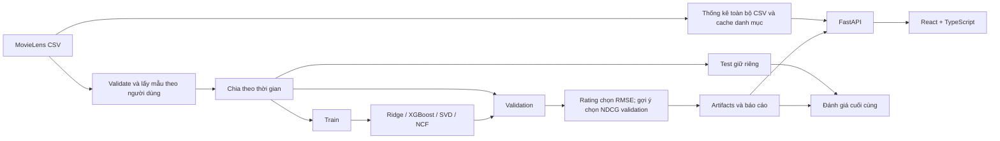

# Phân tích và kiến trúc

## Phạm vi nghiệp vụ

Đầu vào là `userId`, `movieId` và lựa chọn thuật toán; đầu ra là điểm dự đoán 0.5–5.
Người dùng ứng dụng có thể tìm phim, mở trang chi tiết riêng và xem thống kê cộng đồng.
Bảng so sánh thuật toán mở riêng qua nút cài đặt; dự đoán điểm được phục vụ qua API.
Đồ án hỗ trợ rating prediction và Top-N theo tài khoản. Precision/Recall/NDCG@10
được đo trên tối đa 100 warm user với toàn bộ phim đã học, loại lịch sử đã chấm.

## Luồng xử lý

## Trách nhiệm các tầng

- `data`: kiểm tra schema và rating, đọc chunk, lấy mẫu, chia tập và lưu Parquet.
- `models`: cùng giao diện `fit(ratings)` và `predict(user_ids, movie_ids)`.
- `training` / `evaluation`: quản lý run, tính metric, lưu mô hình và bảng so sánh.
- `services`: chọn mô hình theo validation và phục vụ dự đoán.
- `api`: kiểm tra request, phản hồi JSON và cung cấp Swagger.
- `services/catalog`: đọc bốn CSV, thống kê toàn bộ rating, cache danh mục và nhãn.
- `frontend`: React + TypeScript, bộ lọc qua URL, trang chi tiết `/movies/:movieId`.
- `services/accounts`: SQLite cho tài khoản, phiên đăng nhập và tin nhắn liên hệ;
  mật khẩu PBKDF2 có salt, phiên opaque qua cookie HttpOnly.

Huấn luyện chạy qua CLI để không giữ một HTTP request trong suốt quá trình dài.
API phục vụ dữ liệu, dự đoán và tài khoản; cache tối đa một mô hình mỗi service để hạn chế RAM.
Danh mục được cache trên đĩa và trong tiến trình API. Dấu vết đường dẫn, kích thước,
mtime CSV được kiểm tra khi truy cập để tái sử dụng hoặc tạo lại cache tự động.
Thống kê cộng đồng dùng mọi lượt đánh giá; thống kê huấn luyện vẫn chỉ dùng train.

## Dữ liệu và mở rộng

Giai đoạn này dùng `ratings.csv`, `movies.csv` cho học máy; các tập đã xử lý lưu Parquet,
mô hình lưu joblib. SQLite chỉ lưu dữ liệu ứng dụng (tài khoản/phiên/tin nhắn),
không sao chép 25M rating vào SQLite. `links.csv` cung cấp liên kết IMDb/TMDB;
`tags.csv` cung cấp từ khóa cộng đồng trong trang chi tiết. Poster là tranh AI khớp
ID phim hoặc khung đồ họa có tên phim. Các nhãn không tham gia huấn luyện bốn mô hình hiện tại.

Không dựng ma trận đặc user × movie. Item-KNN dùng CSR và tính tương đồng theo block;
SVD/NMF lưu nhân tố user × factors và movie × factors. Chi phí Item-KNN vẫn tăng lớn
khi dùng toàn bộ dữ liệu; block chỉ giới hạn bộ nhớ trung gian, không loại bỏ chi phí
tính tương đồng. Đo tài nguyên thực tế trước khi chọn cấu hình chạy 25M.

## Các bước tiếp theo

1. Chạy `prepare`, kiểm tra thống kê tập đã chia và tỷ lệ cold start.
2. Mở rộng [phân tích dataset](dataset-analysis.md) về lịch sử người dùng.
3. Thử tham số trên validation; cố định cấu hình, rồi báo cáo test.
4. Thay thông tin nhóm minh họa bằng thông tin thành viên thực tế khi có.
5. Nếu mở rộng triển khai nhiều người dùng: bổ sung job queue, xác minh tài khoản
   và chính sách vận hành theo yêu cầu thực tế.
